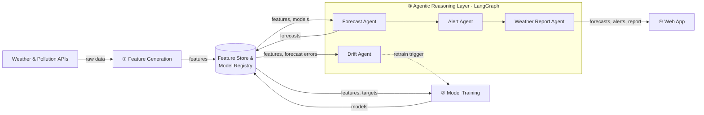

<div align="center">

# 🌦️ AgentWeather

### Agentic Multi-Metric Weather & AQI Forecasting System

**Six metrics. 24 hours ahead. Four LangGraph agents. Zero servers to babysit.**

[](https://www.python.org/)
[](https://www.langchain.com/langgraph)
[](https://www.hopsworks.ai/)
[](https://github.com/features/actions)
[](https://streamlit.io/)

**[🚀 Live Dashboard](#)** · **[📄 Project Report](#)** · **[🐛 Report a Bug](../../issues)**

*Built for the 10Pearls SHINE Internship, Cohort 10 (2026)*

</div>

---

## ✨ What is AgentWeather?

AgentWeather forecasts **six weather and air-quality metrics for the next 24 hours** on a fully managed, serverless stack. On top of the forecasting models sits a **LangGraph agent layer** that:

- 🔮 produces the forecast,
- 🚨 writes hazard alerts tailored to different audiences,
- 📰 composes a news-style weather report,
- 📉 watches for data and model drift and triggers retraining on its own.

Every agent decision is logged, so the system is auditable end to end.

---

## 🎯 Metrics Predicted

| # | Metric | Unit |
|---|--------|------|
| 1 | **Air Quality Index (AQI)** | index |
| 2 | **Temperature** | °C |
| 3 | **Precipitation** | mm and rain probability |
| 4 | **Humidity** | % |
| 5 | **UV Index** | index |
| 6 | **Wind** | speed and direction |

Models are evaluated with **RMSE, MAE and R²**, and always compared against a **naive baseline** (the value from 24 hours ago).

---

## 🏗️ Architecture



**Four stages:** ingest and engineer features → train and register models → reason with agents → serve through a dashboard.

---

## 🤖 The Agents

All four agents are nodes of **one LangGraph graph** sharing a single state, persisted in the **Forecast Ledger** between runs.

| Agent | Runs | What it does |
|-------|------|--------------|
| **🔮 Forecast** | Hourly, after ingestion | Loads the latest features and the best model from the Model Registry, produces the 24h-ahead forecast for each metric, saves it to the Feature Store, and hands it to the Alert and Report agents. |
| **🚨 Alert** | Hourly, after Forecast | Fixed rules check all six metrics for hazards. When one triggers, an LLM writes the alert for the **general public**, **sensitive groups** and **outdoor workers**. |
| **📰 Weather Report** | Daily, and after a new alert | Writes one news-style report from the forecasts and alerts. |
| **📉 Drift** | Hourly, after Alert | Runs **data drift** (live vs. training features) and **model drift** (recent forecast error vs. validation error) detection. Alerts the team and starts an extra training run when a threshold is crossed. |

> The Alert and Weather Report agents can use any LLM (e.g. the free **Groq** API) and ship with **fallbacks** so a failed call never breaks the pipeline.

### 🧾 Everything is logged

| Log | Contents |
|-----|----------|
| **Forecast Ledger** | Every forecast made: time, metric, forecast |
| **Agent Call Log** | Prompt, response, latency and status of every LLM call (failed calls form the failure log) |
| **Drift Log** | Each drift event: time, metric, drift type, score, threshold, action taken |

---

## 🔧 Pipelines

### 1. Feature pipeline (hourly)
1. Fetch weather and pollutant data for the chosen city
2. Fuse and time-align sources into one record per timestamp
3. Impute missing values with a documented strategy
4. Compute features: time-based (hour, day, month) and derived (rate-of-change, rolling averages)
5. Store features and raw observations in the **Hopsworks** Feature Store

### 2. Backfill
The same script runs over past dates to build training data. Targets are created by shifting observations **24 hours ahead**; the newest 24 hours have no target yet and are used for forecasting only.

### 3. Training pipeline (daily, and on drift)
1. Fetch features and targets from the Feature Store
2. Train and evaluate **at least 3 models from different families** with a **time-based split**:
   - 📈 Statistical (e.g. SARIMAX, Prophet)
   - 🌲 Classical ML (e.g. Ridge, Random Forest)
   - 🧠 Deep learning (e.g. LSTM)
3. Compare against the naive baseline and report scores per metric
4. Push to the Model Registry. **A new model replaces the current one only if it scores better on validation.**

---

## ⚙️ CI/CD (GitHub Actions)

| Job | Schedule |
|-----|----------|
| 📥 Feature / ingestion script | Every hour |
| 🏋️ Training script | Every day, and on drift |

---

## 📊 Dashboard

Deployed on a free host and presented as a weather report:

- 🌡️ **24h forecasts** for all six metrics
- 📰 **News-style weather report**
- 🤖 **Agent Activity panel** with alerts
- 🔍 **EDA** and **SHAP / LIME** explanations
- 📉 **Drift events and metrics**, plus failed agent calls

---

## 🧰 Tech Stack

| Layer | Tools |
|-------|-------|
| Language | Python |
| Data sources | OpenWeather, AQICN *(or any available source)* |
| Feature Store & Model Registry | Hopsworks (free tier) |
| Modelling | SARIMAX / Prophet, scikit-learn, LSTM |
| Explainability | SHAP / LIME |
| Agents | LangGraph + LLM (e.g. Groq) |
| Automation | GitHub Actions |
| Dashboard | Streamlit Community Cloud / HuggingFace Spaces / Render |

---

## 📁 Project Structure

> Adjust to match your actual layout.

```
AgentWeather/
├── .github/workflows/
│   ├── feature_pipeline.yml      # hourly ingestion
│   └── training_pipeline.yml     # daily + drift-triggered training
├── src/
│   ├── ingestion/                # API clients, fusion, imputation
│   ├── features/                 # feature engineering
│   ├── training/                 # models, evaluation, registry push
│   ├── agents/                   # forecast, alert, report, drift (LangGraph)
│   └── logging/                  # forecast ledger, agent call log, drift log
├── notebooks/                    # EDA + explainability
├── dashboard/                    # Streamlit app
├── scripts/
│   └── backfill.py
├── requirements.txt
├── .env.example
└── README.md
```

---

## 🚀 Getting Started

### Prerequisites
- Python 3.10+
- A [Hopsworks](https://www.hopsworks.ai/) account (free tier)
- API keys for your weather / AQI sources
- An LLM API key (e.g. [Groq](https://groq.com/))

### Installation

```bash
git clone https://github.com/<your-username>/AgentWeather.git
cd AgentWeather
python -m venv venv
source venv/bin/activate        # Windows: venv\Scripts\activate
pip install -r requirements.txt
```

### Configuration

Copy `.env.example` to `.env` and fill in your keys:

```env
OPENWEATHER_API_KEY=your_key
AQICN_API_KEY=your_key
HOPSWORKS_API_KEY=your_key
GROQ_API_KEY=your_key
CITY=your_city
```

For GitHub Actions, add the same values under **Settings → Secrets and variables → Actions**.

### Run it

```bash
# 1. Backfill historical data
python scripts/backfill.py --start 2025-01-01 --end 2026-01-01

# 2. Run the hourly feature pipeline once
python -m src.ingestion.run

# 3. Train and register models
python -m src.training.run

# 4. Run the agent graph
python -m src.agents.run

# 5. Launch the dashboard
streamlit run dashboard/app.py
```

---

## 📈 Results

> Fill in after training.

| Metric | Naive baseline (RMSE) | Best model | RMSE | MAE | R² |
|--------|-----------------------|------------|------|-----|-----|
| AQI | – | – | – | – | – |
| Temperature | – | – | – | – | – |
| Precipitation | – | – | – | – | – |
| Humidity | – | – | – | – | – |
| UV Index | – | – | – | – | – |
| Wind | – | – | – | – | – |

---

## 🗺️ Roadmap

- [ ] Hourly feature pipeline + Hopsworks integration
- [ ] Historical backfill
- [ ] EDA on all six metrics
- [ ] Train 3+ model families with time-based split
- [ ] Model Registry with validation-gated promotion
- [ ] LangGraph agent graph (Forecast, Alert, Report, Drift)
- [ ] Forecast Ledger, Agent Call Log, Drift Log
- [ ] SHAP / LIME explanations
- [ ] GitHub Actions automation
- [ ] Deployed dashboard
- [ ] Final report

---

## 🙌 Acknowledgements

Built as part of the **10Pearls SHINE Internship, Cohort 10 (2026)**.

## 👤 Author

**Mian Daniyal Hassan**


---

<div align="center">

⭐ If you found this useful, consider starring the repo!

</div>
